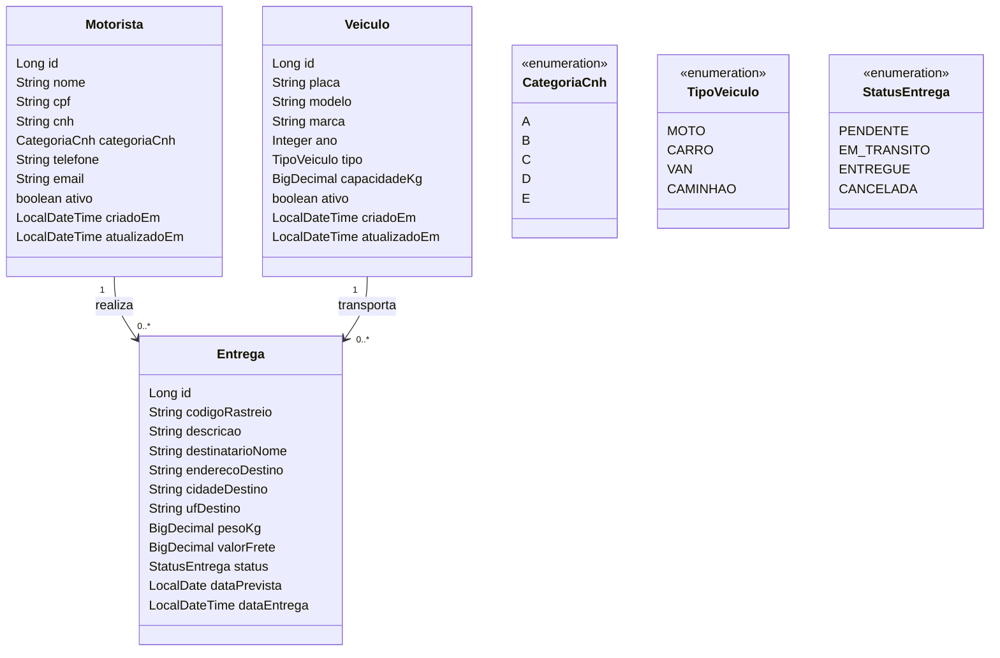

# 🚚 LogiTrack API — Gestão de Entregas

API RESTful para uma transportadora gerenciar **motoristas**, **veículos** e **entregas**.

## Tema e aplicação

- **Tema:** Logística e Transporte 🚚
- **Aplicação:** LogiTrack — backend para controle da frota e das entregas de uma transportadora.

## Integrantes

| Nome | Papel |
|------|-------|
| _(preencher)_ | Modelagem / entidades e banco |
| _(preencher)_ | Services, regras de negócio e validação |
| _(preencher)_ | Controllers, paginação, filtros e ordenação |
| _(preencher)_ | Documentação, testes e carta-desafio |

## Problema

Transportadoras de pequeno porte controlam entregas em planilhas: não sabem qual motorista está com qual veículo, alocam cargas acima da capacidade do veículo, escalam motoristas sem a categoria de CNH correta e não têm rastreio do status das entregas. A LogiTrack centraliza esses dados e aplica as regras automaticamente.

## Domínio

| Entidade | Descrição |
|----------|-----------|
| **Motorista** | Condutor da transportadora: nome, CPF, CNH, categoria da CNH (A–E), telefone, e-mail, ativo. |
| **Veiculo** | Veículo da frota: placa, modelo, marca, ano, tipo (MOTO, CARRO, VAN, CAMINHAO), capacidade em kg, ativo. |
| **Entrega** | Carga a ser entregue: código de rastreio, descrição, destinatário, endereço/cidade/UF, peso, frete, status, data prevista e data de entrega. |

**Relacionamentos**
- Motorista **1:N** Entrega — um motorista realiza várias entregas; cada entrega tem um motorista.
- Veiculo **1:N** Entrega — um veículo é usado em várias entregas; cada entrega usa um veículo.

**Regras de negócio principais**
- CPF, CNH, e-mail e placa são únicos (409 Conflict).
- Peso da entrega ≤ capacidade do veículo (422).
- Categoria da CNH compatível com o tipo do veículo (ex.: CAMINHAO exige C, D ou E) (422).
- Motorista/veículo inativo não recebe entregas (422).
- Entregas ENTREGUE ou CANCELADA não podem ser alteradas (422).
- Motorista/veículo com entregas vinculadas não pode ser excluído (409).

## Diagrama UML (inicial)



## Tecnologias

Java 21 · Spring Boot 3.5 (Web, Data JPA, Validation) · PostgreSQL · Flyway · Springdoc OpenAPI (Swagger) · Maven

## Arquitetura

```
controller/  -> recebe HTTP, valida DTO (@Valid), devolve status
service/     -> regras de negócio e transações
repository/  -> Spring Data JPA + Specifications (filtros)
dto/         -> DTOs de entrada (Request/Update) e saída (Response/Resumo)
mapper/      -> conversão entidade <-> DTO
exception/   -> exceções + GlobalExceptionHandler (400, 404, 409, 422, 500)
```

## Endpoints planejados

| Recurso | Endpoints |
|---------|-----------|
| Motoristas | `GET /motoristas` · `GET /motoristas/{id}` · `POST /motoristas` · `PUT /motoristas/{id}` · `DELETE /motoristas/{id}` |
| Veículos | `GET /veiculos` · `GET /veiculos/{id}` · `POST /veiculos` · `PUT /veiculos/{id}` · `DELETE /veiculos/{id}` |
| Entregas | `GET /entregas` · `GET /entregas/{id}` · `POST /entregas` · `PUT /entregas/{id}` · `DELETE /entregas/{id}` |

Listagens com paginação (`page`, `size`), ordenação (`sort=campo,asc|desc`) e filtros (ex.: `GET /entregas?status=PENDENTE&uf=SP&sort=dataPrevista,asc`).

## Carta-desafio

_A definir após o sorteio (19/11)._

## Status

🚧 E1 — domínio e UML definidos; API base em desenvolvimento (entrega E2 em 26/11).
